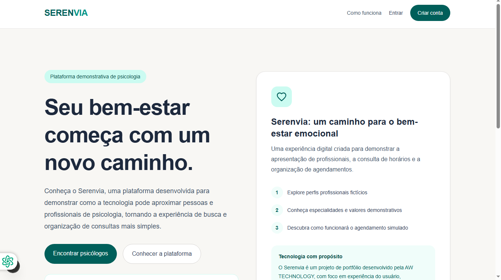
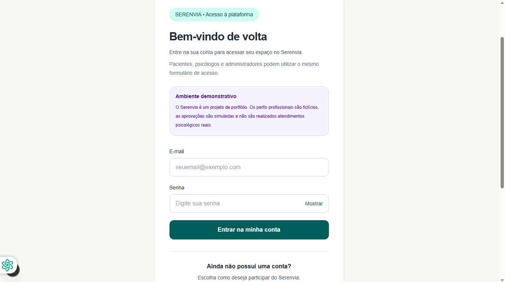
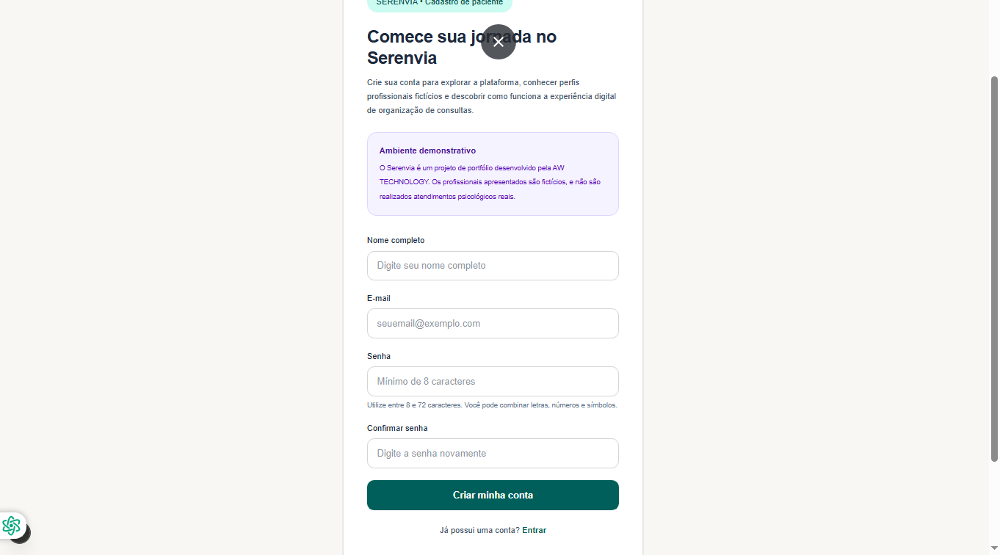
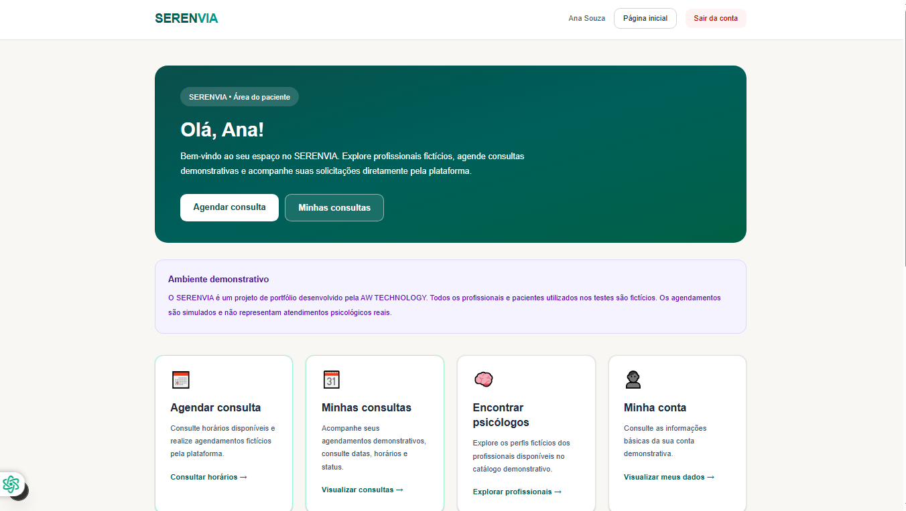
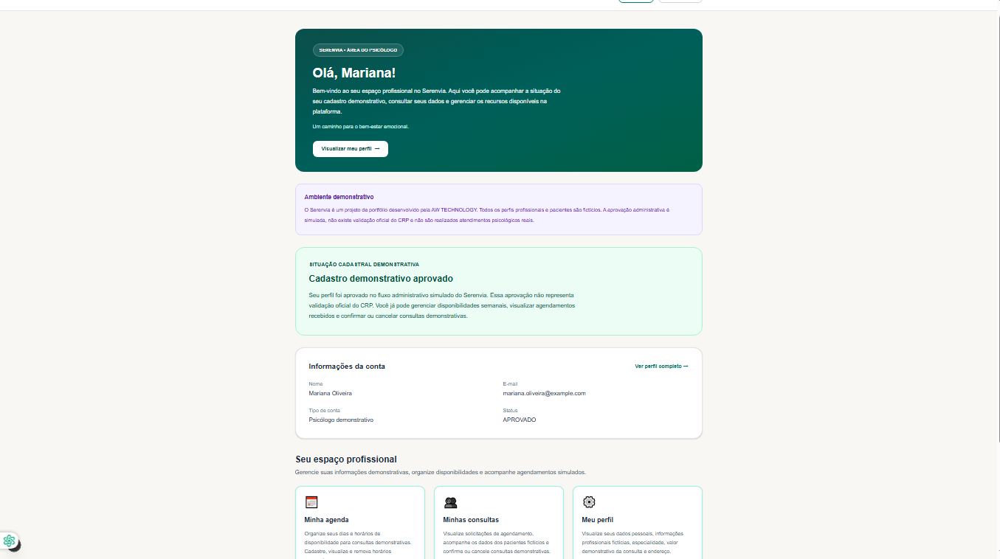
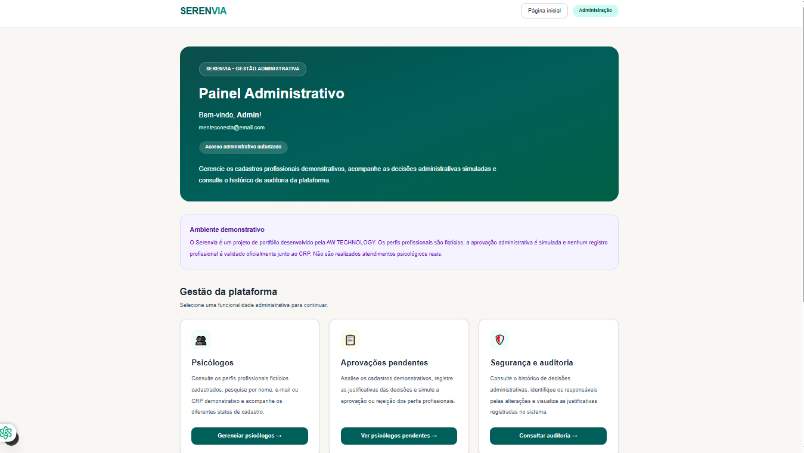

# 🧠 SERENVIA

### Plataforma Demonstrativa de Agendamento Psicológico

**Desenvolvido por AW TECHNOLOGY**

O **SERENVIA** é uma plataforma web demonstrativa que simula o gerenciamento de consultas psicológicas, reunindo funcionalidades para pacientes, psicólogos e administradores em ambientes específicos para cada perfil.

O projeto foi desenvolvido para demonstrar conhecimentos em desenvolvimento full stack, autenticação, controle de acesso, gerenciamento de usuários e organização de agendamentos com integração a banco de dados.

> **⚠️ Aviso importante:** o SERENVIA é um projeto demonstrativo para fins de estudo e portfólio. Os usuários e atendimentos utilizados nas demonstrações são fictícios. A plataforma não oferece atendimento psicológico real e não está preparada para processar dados clínicos ou atender pacientes reais.

---

## 🚀 Funcionalidades

### 👤 Área do Paciente

- Cadastro de pacientes e autenticação.
- Visualização de psicólogos disponíveis.
- Consulta de horários disponíveis.
- Agendamento de consultas.
- Reagendamento de agendamentos.
- Cancelamento de consultas.
- Acompanhamento dos agendamentos e respectivos status.

### 🧑‍⚕️ Área do Psicólogo

- Cadastro profissional.
- Visualização e atualização do perfil profissional.
- Configuração e gerenciamento de disponibilidades.
- Consulta dos próprios agendamentos.
- Confirmação de consultas.
- Cancelamento de consultas.
- Registro de conclusão de atendimentos.

### 🛡️ Área Administrativa

- Acesso administrativo.
- Consulta de psicólogos cadastrados.
- Visualização de cadastros pendentes de análise.
- Análise de informações profissionais.
- Aprovação ou rejeição de cadastros.
- Gerenciamento do status dos psicólogos.
- Reabertura de análises.
- Consulta de registros de auditoria.

---

## 🛠️ Tecnologias Utilizadas

### Frontend

- **Next.js** — estrutura da aplicação web.
- **React** — construção das interfaces.
- **TypeScript** — tipagem estática.
- **Tailwind CSS** — estilização da interface.

### Backend

- **Node.js** — ambiente de execução.
- **Express** — construção da API.
- **TypeScript** — desenvolvimento tipado.
- **Prisma ORM** — acesso e gerenciamento dos dados.

### Banco de Dados

- **PostgreSQL** — banco de dados relacional.
- **Neon** — serviço de banco de dados PostgreSQL em nuvem.

### Ferramentas

- **Git** — controle de versão.
- **GitHub** — hospedagem do código-fonte.

---

## 🏗️ Estrutura do Projeto

```text
serenvia/
├── backend/
│   ├── prisma/
│   ├── scripts/
│   ├── src/
│   │   ├── lib/
│   │   ├── routes/
│   │   │   ├── admin.ts
│   │   │   ├── agenda.ts
│   │   │   ├── auth.ts
│   │   │   ├── pacientes.ts
│   │   │   └── psicologos.ts
│   │   └── server.ts
│   └── package.json
│
├── frontend/
│   ├── public/
│   ├── src/
│   │   └── app/
│   │       ├── admin/
│   │       ├── cadastro/
│   │       ├── cadastro-psicologo/
│   │       ├── login/
│   │       ├── paciente/
│   │       ├── psicologo/
│   │       └── psicologos/
│   └── package.json
│
├── docs/
│   └── screenshots/
│       ├── serenvia-home.png
│       ├── serenvia-login.png
│       ├── serenvia-cadastro.png
│       ├── serenvia-painel-paciente.png
│       ├── serenvia-painel-psicologo.png
│       └── serenvia-painel-admin.png
│
└── README.md
```

---

## 🔐 Autenticação e Controle de Acesso

O backend utiliza autenticação baseada em **JWT (JSON Web Token)** e organiza o acesso conforme os perfis de usuário.

A estrutura contempla ambientes específicos para pacientes, psicólogos e administradores, com operações próprias para cada área.

> **Nota de segurança:** a implementação tem finalidade demonstrativa. O projeto não possui certificação de segurança para uso clínico e não deve ser utilizado para armazenar dados reais de pacientes sem uma avaliação técnica, jurídica e de privacidade apropriada.

---

## 📅 Gerenciamento de Agendamentos

O módulo de agenda contempla operações para:

- Consultar disponibilidades.
- Cadastrar e remover horários disponíveis.
- Consultar horários para agendamento.
- Criar agendamentos.
- Consultar agendamentos do paciente.
- Consultar agendamentos do psicólogo.
- Confirmar consultas.
- Cancelar consultas pelo paciente ou psicólogo.
- Reagendar consultas.
- Registrar a conclusão de atendimentos.

Os agendamentos são acompanhados por status, incluindo **Pendente**, **Confirmado**, **Cancelado** e **Concluído**, conforme o fluxo demonstrativo da aplicação.

---

## 📸 Demonstração da Plataforma

### 🏠 Página Inicial



*Página inicial do SERENVIA, apresentando a proposta visual da plataforma.*

### 🔐 Tela de Login



*Interface de autenticação para acesso à plataforma.*

### 📝 Tela de Cadastro



*Interface para criação de uma conta de usuário.*

### 👤 Painel do Paciente



*Área do paciente para acesso aos recursos de agendamento.*

### 🩺 Painel do Psicólogo



*Área profissional para gerenciamento de perfil, disponibilidade e consultas.*

### ⚙️ Painel Administrativo



*Área administrativa para análise e gerenciamento de cadastros profissionais.*

---

## 📌 Status do Projeto

**Versão demonstrativa funcional — em desenvolvimento.**

O SERENVIA reúne funcionalidades demonstrativas de autenticação, gerenciamento de perfis profissionais e agendamentos.

O projeto poderá receber novas funcionalidades, melhorias de interface e aprimoramentos técnicos.

**Importante:** a plataforma não está preparada para utilização com pacientes reais, processamento de pagamentos reais ou armazenamento de dados clínicos.

---

## 👨‍💻 Desenvolvimento

**AW TECHNOLOGY**

Soluções inteligentes em software para negócios, desenvolvimento de sistemas web e plataformas personalizadas.

**Desenvolvedor:** André Waldige

**GitHub:** [@awaldige](https://github.com/awaldige)

---

## 🎯 Objetivo do Projeto

O SERENVIA integra o portfólio técnico da AW TECHNOLOGY e demonstra a aplicação prática de conhecimentos em:

- Desenvolvimento full stack.
- Construção de interfaces web.
- Desenvolvimento de APIs REST.
- Autenticação e controle de acesso.
- Gerenciamento de usuários e perfis.
- Agendamento e gerenciamento de horários.
- Integração com banco de dados relacional.
- Organização de código e controle de versão.

---

**SERENVIA — Projeto demonstrativo desenvolvido por AW TECHNOLOGY.**